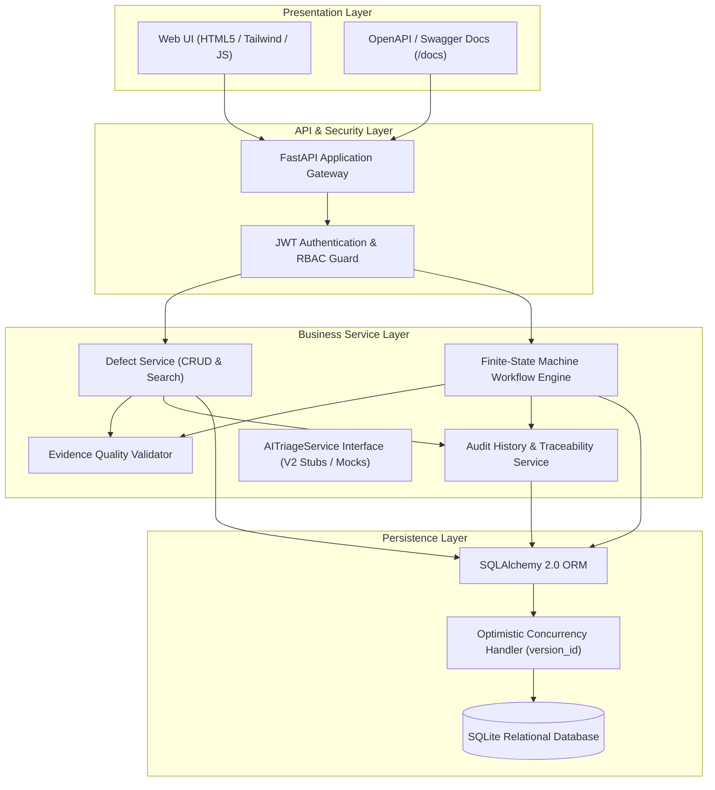
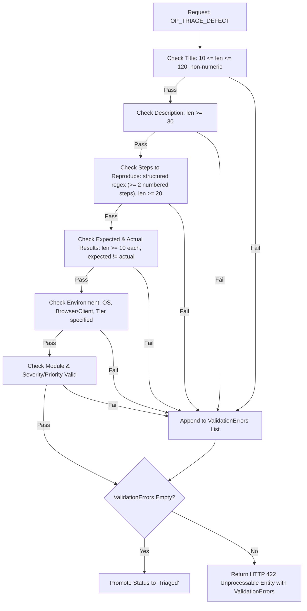

# System Architecture & Technical Design Specification — Version 1.0 Baseline

**Course:** CISC 594 – Software Testing Principles & Techniques (Harrisburg University)  
**Project Name:** AI-Assisted Bug Triage & Defect Management System  
**Document Reference:** `docs/architecture.md`  
**Version:** 1.0 (Version 1 Baseline with V2 Integration Interfaces)  

---

## 1. Architectural Philosophy & Principles

In alignment with course engineering instructions (§25, §29), the architecture prioritizes **clarity, testability, deterministic behavior, and strict separation of concerns** over unnecessary operational complexity.

### Core Architectural Principles:
1. **Appropriately Simple (No Overengineering):** Monolithic modular architecture. Avoids distributed microservices, message queues (Kafka/RabbitMQ), and container orchestrators (Kubernetes).
2. **Layered Separation of Concerns:** Strict decoupling between presentation, authorization, business logic, and data persistence.
3. **Deterministic Core:** Version 1 workflows have 0% dependency on external network services, heuristic models, or AI APIs.
4. **Testability by Design:** All services, validation rules, state transitions, and concurrency locks can be instantiated and verified in isolated unit and integration test harnesses using `pytest`.
5. **V2 Decoupling (Open-Closed Principle):** Future AI services are abstracted behind strict interfaces (`AITriageService`), ensuring that Version 2 additions do not mutate or compromise Version 1 baselines.

---

## 2. Technology Stack Selection & Rationale

| Layer | Selected Technology | Version | Engineering Rationale |
| :--- | :--- | :--- | :--- |
| **Language** | **Python** | 3.11+ | Strong standard library, rapid pair programming, industry-standard testing tools (`pytest`), and native AI/data science libraries for Version 2. |
| **API Framework** | **FastAPI** | 0.110+ | High-performance asynchronous REST framework. Provides auto-generated OpenAPI documentation, strict request validation via Pydantic, and native dependency injection for RBAC. |
| **Data Validation** | **Pydantic v2** | 2.6+ | High-speed deterministic data validation, schema enforcement, boundary checking, and custom validators for the Evidence Quality Gate. |
| **ORM & Data Layer** | **SQLAlchemy** | 2.0+ | Modern Python ORM providing typed models, atomic database transactions, unit-of-work patterns, and native optimistic concurrency locking (`version_id_col`). |
| **Database** | **SQLite** | 3.x | Lightweight, zero-configuration relational database. Provides atomic transactions and file-based persistence for system tests, and ephemeral in-memory databases (`sqlite:///:memory:`) for instantaneous, isolated test runs. |
| **Migrations** | **Alembic** | 1.13+ | Version-controlled database schema migrations ensuring reproducible database baselines across environments. |
| **Security & Auth** | **Passlib (BCrypt)** & **Python-Jose** | Latest | Industry-standard password hashing with salting and stateless cryptographic JWT (JSON Web Token) authentication. |
| **Frontend UI** | **Jinja2 + HTML5 / TailwindCSS / Vanilla JS** | Modern | Clean, responsive, multi-role web interface served directly by FastAPI without bloated JavaScript build toolchains or node dependency overhead. |
| **Testing Harness** | **Pytest**, **Pytest-Cov**, **HTTPX** | Latest | Multi-level test runner for unit, integration, and full end-to-end API system testing with statement coverage reporting. |

---

## 3. High-Level Component Architecture

The diagram below illustrates the layered architecture and component interaction:



---

## 4. Domain Data Model & Entity Schemas

### 4.1 `User` Entity
Represents system actors and role credentials.

```python
class User:
    id: int                     # Primary Key
    username: str               # Unique login name
    email: str                  # Unique contact email
    password_hash: str          # Salted BCrypt password hash
    role: str                   # ROLE_REPORTER | ROLE_DEVELOPER | ROLE_QA_TRIAGE | ROLE_ADMIN
    is_active: bool             # Account active flag
    created_at: datetime        # Account creation timestamp
```

### 4.2 `Defect` Entity
Core defect record maintaining full engineering evidence, workflow state, and concurrency tokens.

```python
class Defect:
    id: str                     # Primary Key (e.g., "DEF-1001" or UUID)
    title: str                  # Defect summary (10 - 120 chars)
    description: str            # Detailed defect context (min 30 chars)
    steps_to_reproduce: str     # Structured reproduction steps (min 2 steps, 20 chars)
    expected_result: str        # Expected behavior per specification (min 10 chars)
    actual_result: str          # Observed anomalous behavior (min 10 chars)
    environment: str            # OS, browser, application version, deployment tier
    module: str                 # Affected system component
    severity: str               # Blocker | Critical | Major | Minor | Trivial
    priority: str               # P1-Immediate | P2-High | P3-Medium | P4-Low
    status: str                 # Open | Triaged | Assigned | In Progress | Fixed | Retest | Closed | Reopened
    
    reporter_id: int            # Foreign Key -> User.id (Immutable after creation)
    assignee_id: Optional[int]  # Foreign Key -> User.id (Nullable when unassigned)
    
    # Resolution Information (Mandatory for 'Fixed')
    root_cause: Optional[str]
    resolution_notes: Optional[str]
    fix_reference: Optional[str] # Commit hash or PR URL
    
    # Verification & Reopen Information
    verification_notes: Optional[str] # Mandatory for 'Closed'
    reopen_reason: Optional[str]      # Mandatory for 'Reopened'
    reopen_count: int = 0             # Increments on each retest failure
    
    # Concurrency & Timestamps
    version: int = 1            # Optimistic Locking Version Token (version_id_col)
    created_at: datetime
    updated_at: datetime
```

### 4.3 `DefectHistory` Entity
Append-only immutable audit ledger recording every state change and critical field mutation.

```python
class DefectHistory:
    id: int                     # Primary Key
    defect_id: str              # Foreign Key -> Defect.id (Indexed)
    changed_by_user_id: int     # Foreign Key -> User.id
    action_type: str            # CREATED | UPDATED | STATUS_CHANGED | ASSIGNED | REOPENED
    field_name: Optional[str]   # Specific field modified (e.g., 'severity', 'status')
    old_value: Optional[str]    # Previous state value
    new_value: Optional[str]    # Updated state value
    version_snapshot: int       # Defect version at time of change
    timestamp: datetime         # UTC audit timestamp
```

---

## 5. Evidence Quality Gate Architecture

The Evidence Quality Gate operates as an independent, deterministic validation pipeline in `EvidenceValidationService`:



---

## 6. Concurrency Control & Optimistic Locking Design

To satisfy `FR-056` through `FR-060` and mitigate `RISK-V1-004`, the system implements **Optimistic Concurrency Control (OCC)**:

1. **Version Field:** Every `Defect` entity maintains an integer `version` initialized to `1`.
2. **Mutation Verification:** When any client submits an update or lifecycle transition, the client must supply the known `version` in the request body or via the `If-Match` header.
3. **Atomic Compare-and-Swap:** In SQLAlchemy, the update query evaluates:
   ```sql
   UPDATE defects 
   SET title = :new_title, version = version + 1, updated_at = :now 
   WHERE id = :defect_id AND version = :expected_version;
   ```
4. **Conflict Detection:** If the row count affected is `0` (indicating another user updated the defect in the interim), SQLAlchemy raises `StaleDataError`.
5. **Conflict Response:** The API traps `StaleDataError` and emits:
   - HTTP Status: `409 Conflict`
   - Payload: Itemized conflict message along with the latest database snapshot of the defect to allow the client to resolve the discrepancy.

---

## 7. Role-Based Access Control (RBAC) Architecture

Authentication and authorization use FastAPI's dependency injection system:

```python
# Declarative Dependency Injection Example
@router.post("/defects/{defect_id}/triage")
def triage_defect(
    defect_id: str,
    current_user: User = Depends(require_roles(["ROLE_QA_TRIAGE", "ROLE_ADMIN"])),
    db: Session = Depends(get_db)
):
    return workflow_service.triage_defect(defect_id, current_user, db)
```

- **Unauthenticated requests** fail immediately at the dependency layer with HTTP `401 Unauthorized`.
- **Role violations** are rejected with HTTP `403 Forbidden` and audited to security logs.
- **Separation of Duties:** For closing and retesting, `WorkflowService` verifies that `current_user.id != defect.resolver_id`, enforcing objective quality verification.

---

## 8. Version 2 AI Service Decoupling & Guardrails

To preserve architectural integrity and prevent AI dependencies from leaking into Version 1:

1. **Interface Abstraction:**
   ```python
   class AITriageService(ABC):
       @abstractmethod
       def detect_duplicates(self, defect: Defect, top_k: int = 5) -> List[DuplicateCandidate]:
           pass

       @abstractmethod
       def recommend_triage(self, defect: Defect) -> TriageRecommendation:
           pass
   ```
2. **Mocking & Isolation in Tests:**
   In Version 1 (and Version 2 test suites), `MockAITriageService` returns deterministic fixture data, guaranteeing test repeatability without external network calls.
3. **Privacy Sanitizer Gateway:**
   In Version 2, all payloads to external LLMs pass through a `PrivacySanitizer` module that redacts API tokens, passwords, email addresses, and proprietary internal IP addresses prior to transmission.
4. **Circuit Breaker / Fail-Open:**
   If the AI service fails or times out, the application logs a warning and falls back immediately to normal manual triage without raising an unhandled exception.
