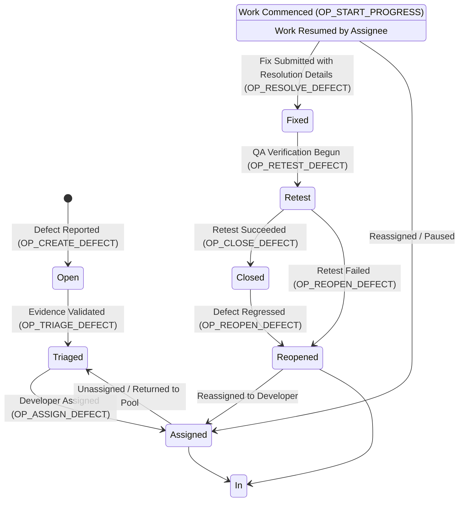

# Defect Lifecycle Workflow & State Transition Specification

**Course:** CISC 594 – Software Testing Principles & Techniques (Harrisburg University)  
**Project Name:** AI-Assisted Bug Triage & Defect Management System  
**Document Reference:** `docs/defect-workflow.md`  
**Version:** 1.0 (Baseline for Version 1)  

---

## 1. Document Purpose

This document provides the formal finite-state machine (FSM) specification for the defect lifecycle. It defines all allowable defect statuses, valid state transitions, illegal transition rules, mandatory pre-conditions, evidence quality gates, and role authorizations.

All workflow logic implemented in the backend application layer must adhere strictly to the rules and matrices documented herein.

---

## 2. Defect Lifecycle States

The defect lifecycle is composed of eight discrete states:

| Status | Identifier | Description |
| :--- | :--- | :--- |
| **Open** | `STATUS_OPEN` | Newly reported defect. May be a draft or awaiting triage. Evidence quality validation has not yet passed. |
| **Triaged** | `STATUS_TRIAGED` | Defect evidence has been formally validated by QA/Triage as complete, reproducible, and actionable. Severity and priority are confirmed. |
| **Assigned** | `STATUS_ASSIGNED` | Defect has been allocated to a specific developer for debugging and remediation. |
| **In Progress** | `STATUS_IN_PROGRESS` | Developer is actively investigating, replicating, or writing a code fix for the defect. |
| **Fixed** | `STATUS_FIXED` | Developer has completed remediation, recorded root cause analysis and resolution notes, and made the fix available for verification. |
| **Retest** | `STATUS_RETEST` | QA engineer is actively retesting the defect in a staging/test environment against the reproduction steps. |
| **Closed** | `STATUS_CLOSED` | Terminal state for successful resolution. QA has verified that the defect is fixed and no regressions were introduced. |
| **Reopened** | `STATUS_REOPENED` | Defect failed retest verification or regressed after closure. Returns to the development queue with failure notes. |

---

## 3. Workflow State Transition Diagram

The following diagram illustrates all permitted transitions in the defect management system:

---

## 4. Evidence Quality Gate (Pre-condition for `Triaged`)

A primary engineering innovation of this system is **defect evidence quality enforcement**. A defect cannot transition from `Open` to `Triaged` unless all evidence criteria are satisfied deterministically.

### Mandatory Evidence Thresholds

| Evidence Field | Validation Criteria | Justification & Quality Rationale |
| :--- | :--- | :--- |
| **Title** | Non-empty; length between 10 and 120 characters; cannot be purely numeric or whitespace. | Ensures concise, searchable identification of the issue. |
| **Description** | Non-empty; minimum 30 characters; must describe symptoms and context. | Prevents vague submissions (e.g., "login broke"). |
| **Steps to Reproduce** | Structured text; minimum 2 distinct numbered steps; minimum 20 characters total. | Guarantees developers have an actionable procedure to replicate the anomaly. |
| **Expected Result** | Non-empty; minimum 10 characters. | Establishes the expected baseline behavior per requirements. |
| **Actual Result** | Non-empty; minimum 10 characters; must differ from Expected Result. | Documents the observed anomalous behavior. |
| **Environment Details** | Non-empty; must specify OS, browser/client version, and target environment (e.g., Staging, Dev, Prod). | Eliminates "works on my machine" triage delays. |
| **Module / Component** | Must reference a recognized system module. | Ensures accurate categorization and triage routing. |

> **Gate Rule:** If any evidence check fails during `OP_TRIAGE_DEFECT`, the transition is rejected with HTTP `422 Unprocessable Entity` containing an itemized list of defective fields. The defect remains in `Open` status until the reporter or QA updates the missing evidence.

---

## 5. Detailed State Transition Matrix

The table below governs all valid and invalid transitions between states:

| From State | To State | Permitted? | Required Pre-conditions | Authorized Roles | History Audit Event |
| :--- | :--- | :---: | :--- | :--- | :--- |
| **Open** | **Triaged** | **YES** | 100% Evidence Quality Gate criteria satisfied; Severity and Priority set. | `QA_TRIAGE`, `ADMIN` | `EVT_STATUS_TRIAGED` |
| **Open** | **Assigned** | NO | Defect must pass evidence triage before assignment. | N/A | Rejected |
| **Open** | **Closed** | NO | Direct closure bypassing triage and retest is strictly forbidden. | N/A | Rejected |
| **Triaged** | **Assigned** | **YES** | Valid active `assignee_id` provided. | `QA_TRIAGE`, `ADMIN`, `DEVELOPER` (self only) | `EVT_STATUS_ASSIGNED` |
| **Triaged** | **Open** | **YES** | Evidence found defective or retracted upon secondary review. | `QA_TRIAGE`, `ADMIN` | `EVT_STATUS_REVERTED_OPEN` |
| **Assigned** | **In Progress** | **YES** | Requesting user must match `assignee_id` or be `ADMIN`. | `DEVELOPER` (assignee), `ADMIN` | `EVT_STATUS_IN_PROGRESS` |
| **Assigned** | **Triaged** | **YES** | Assignee unassigned or returned to queue. | `QA_TRIAGE`, `ADMIN` | `EVT_STATUS_UNASSIGNED` |
| **In Progress** | **Fixed** | **YES** | Non-empty resolution notes, root-cause description, and fix commit/PR reference provided. | `DEVELOPER` (assignee), `ADMIN` | `EVT_STATUS_FIXED` |
| **In Progress** | **Assigned** | **YES** | Work paused or defect reassigned. | `QA_TRIAGE`, `ADMIN` | `EVT_STATUS_PAUSED` |
| **Fixed** | **Retest** | **YES** | Defect deployed to test environment; QA tester designated. | `QA_TRIAGE`, `ADMIN` | `EVT_STATUS_RETEST_START` |
| **Fixed** | **Closed** | NO | Retest is mandatory. Fixed defects cannot bypass Retest. | N/A | Rejected |
| **Retest** | **Closed** | **YES** | Retest verification passed; verification notes attached. | `QA_TRIAGE`, `ADMIN` | `EVT_STATUS_CLOSED` |
| **Retest** | **Reopened** | **YES** | Retest verification failed; specific failure notes and evidence of continued failure attached. | `QA_TRIAGE`, `ADMIN` | `EVT_STATUS_REOPENED_RETEST_FAIL` |
| **Closed** | **Reopened** | **YES** | Defect reoccurred or regressed in subsequent release; regression notes required. | `QA_TRIAGE`, `ADMIN` | `EVT_STATUS_REOPENED_REGRESSION` |
| **Reopened** | **Assigned** | **YES** | Assigned to developer for re-work. | `QA_TRIAGE`, `ADMIN`, `DEVELOPER` (self only) | `EVT_STATUS_ASSIGNED` |
| **Reopened** | **In Progress** | **YES** | Previous assignee resumes investigation immediately. | `DEVELOPER` (assignee), `ADMIN` | `EVT_STATUS_IN_PROGRESS` |

*(All transitions not explicitly marked **YES** above are **STRICTLY FORBIDDEN** and must be rejected with HTTP `400 Bad Request`).*

---

## 6. Prohibited (Illegal) Transitions

To ensure lifecycle integrity, the backend finite-state machine explicitly guards against the following invalid operations:

1. **Bypassing Triage (`Open` &rarr; `In Progress`, `Open` &rarr; `Closed`):**  
   Untriaged defects cannot be worked on or closed. Quality assurance must validate evidence first.

2. **Bypassing Retest (`Fixed` &rarr; `Closed`):**  
   Developers cannot mark a defect closed upon submitting a fix. An independent retest verification by QA is mandatory.

3. **Premature Progress (`Triaged` &rarr; `In Progress`):**  
   A defect must have an explicit, recorded assignee before moving to `In Progress` to guarantee personal accountability.

4. **Resolution Without Details (`In Progress` &rarr; `Fixed` without resolution):**  
   Transitions to `Fixed` without root-cause documentation and fix notes are rejected.

5. **Self-Closing by Developer:**  
   Developers are blocked by authorization rules from transitioning defects to `Closed`.

---

## 7. Reopen & Closure Governance

### Reopen Rules (`OP_REOPEN_DEFECT`)
- A defect may only be reopened from `Retest` (verification failure) or `Closed` (regression).
- Reopening requires:
  1. Mandatory `reopen_reason` (minimum 20 characters).
  2. New actual result or failure logs attached as updated evidence.
- The defect's retest failure count (`reopen_count`) increments by 1 in the audit record.

### Closure Rules (`OP_CLOSE_DEFECT`)
- A defect may only be closed from `Retest`.
- Closure requires:
  1. Mandatory `verification_notes` (minimum 15 characters) documenting the build number and test environment where verification succeeded.
  2. The closing user must be distinct from the developer who marked the defect `Fixed` (separation of duties), unless the closing user is an `ADMIN` performing an audited emergency override.

---

## 8. Concurrency & Audit Traceability Rules

1. **Every Status Change Appends an Audit Record:**  
   Every state transition automatically generates an immutable audit record capturing:
   - `defect_id`
   - `from_status` and `to_status`
   - `changed_by_user_id`
   - `timestamp`
   - `status_change_reason` / resolution notes
   - Previous and updated concurrency `version` tokens

2. **Optimistic Locking Guard:**  
   Every state transition must submit the current `version` token. If the version in the database is greater than the submitted version (indicating a concurrent update occurred), the transition is rejected with HTTP `409 Conflict`.
