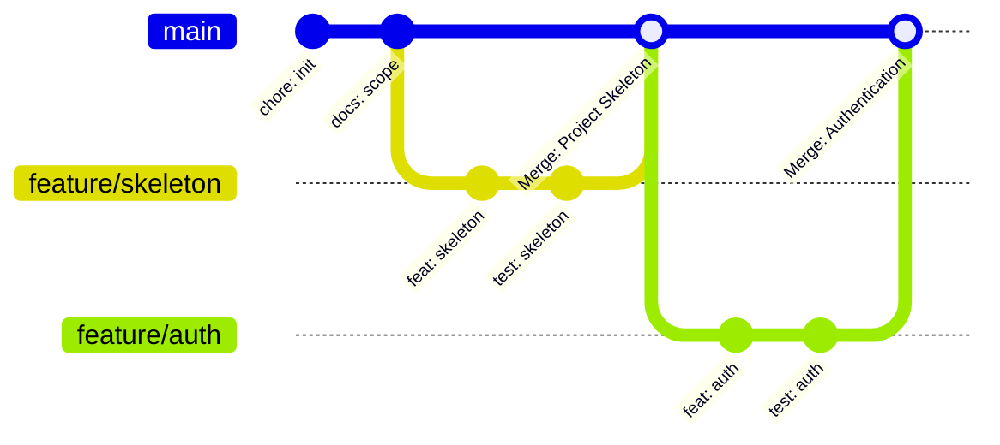

# Software Configuration Management (SCM) Plan — Version 1.0 Baseline

**Course:** CISC 594 – Software Testing Principles & Techniques (Harrisburg University)  
**Project Name:** AI-Assisted Bug Triage & Defect Management System  
**Document Reference:** `docs/scm-plan.md`  
**Version:** 1.0 (Version 1 Baseline)  

---

## 1. SCM Purpose & Scope

This Software Configuration Management (SCM) Plan establishes the policies, procedures, and engineering conventions governing the evolution of the defect management codebase. 

In accordance with course standards, every code and documentation modification must be **controlled, traceable, reviewed, and tested prior to integration**.

---

## 2. Configuration Items (CIs)

The following items are under formal version control:

1. **Source Code:** Backend application, service layer, data models, REST endpoints, and Web UI.
2. **Database Migrations:** Version-controlled Alembic migration scripts.
3. **Automated Test Suites:** Unit, integration, system, and regression test scripts under `tests/`.
4. **Documentation:** Engineering specifications, requirements, workflows, RBAC matrix, test plans, risk registers, and system test execution evidence under `docs/`.
5. **Project Configuration:** Dependency manifests (`requirements.txt`), linting configs, and GitHub workflows.

---

## 3. Branching Strategy & Git Workflow

The repository enforces a strict **Feature-Branch Workflow** anchored on `main`. Direct commits to `main` are strictly prohibited.

### Branch Naming Conventions:
- **Features:** `feature/<actual-issue-number>-<short-slug>` (e.g., `feature/10-auth-and-rbac`, `feature/12-defect-creation`)
- **Bug Fixes:** `fix/<actual-issue-number>-<short-slug>` (e.g., `fix/25-invalid-transition`)
- **Testing:** `test/<actual-issue-number>-<short-slug>` (e.g., `test/20-v1-system-testing`)
- **Documentation:** `docs/<topic-slug>` (e.g., `docs/traceability-cleanup`)

---

## 4. Change Control & GitHub Issue Workflow

Every code change must originate from a formal GitHub Issue. The lifecycle of a change follows this strict state machine:

$$\text{GitHub Issue} \longrightarrow \text{Branch} \longrightarrow \text{Code + Tests} \longrightarrow \text{Test Pass} \longrightarrow \text{Commit} \longrightarrow \text{PR} \longrightarrow \text{Review} \longrightarrow \text{Merge} \longrightarrow \text{Close Issue}$$

### Commit Message Standards (Conventional Commits):
Every commit must use conventional semantic prefixes:
- `feat:` New user-facing or API functionality.
- `fix:` Bug fix or defect correction.
- `test:` Adding or updating automated tests.
- `docs:` Documentation-only changes.
- `refactor:` Code change that neither fixes a bug nor adds a feature.
- `chore:` Build, configuration, or repository maintenance tasks.

---

## 5. Pull Request & Quality Merge Gates

No Pull Request may be merged into `main` unless it satisfies the following **Merge Gates**:
1. **Traceability:** Links directly to an approved GitHub Issue and identifies the `FR-xxx` requirements addressed.
2. **Automated Verification:** 100% of existing regression tests and newly added unit/integration tests must pass.
3. **No Unhandled Regressions:** Coverage across altered modules must meet or exceed 85%.
4. **Documentation Synchronization:** If API contracts or domain models changed, related docs (`architecture.md`, `requirements.md`) must be updated in the same PR.
5. **No Direct Code Merges:** Merges must use non-fast-forward or squash merge with descriptive PR titles.

---

## 6. Baseline & Release Versioning Strategy

The project employs **Semantic Versioning (SemVer 2.0)**:

$$\text{MAJOR}.\text{MINOR}.\text{PATCH}$$

- **`v1.0.0` (First Stable Baseline):** Tagged upon successful completion of Phase 10 System Testing. Represents the deterministic, AI-free core defect management system.
- **`v2.0.0` (Second Major Release):** Tagged upon successful implementation and empirical evaluation of AI-assisted duplicate detection and advisory triage.

> **Baseline Integrity Rule:** No work on Version 2 may begin until `v1.0.0` has passed full system testing and is tagged in Git.
